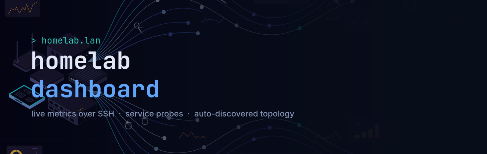
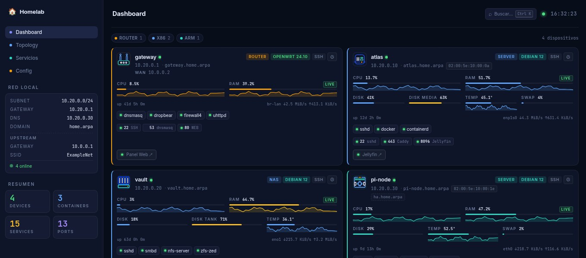

# Homelab Dashboard

A live control panel for a small homelab. Devices, services and network
topology come from one YAML file plus real measurements: CPU, RAM, disk,
temperature and throughput polled over SSH; HTTP/TCP reachability probed
from the server; and the network map discovered automatically by
[netmap](https://github.com/aurelioochoa/netmap).

Dark "terminal glass" UI, keyboard-driven, deep-linkable.



## Features

**Live data**
- **Real metrics per device** — CPU, RAM, swap, per-filesystem disk usage,
  thermal sensors and per-interface throughput, with sparkline history.
- **Reachability probes** — every service port and web link is probed from
  the backend with a response time, replacing hand-maintained `status:`
  strings that were only as accurate as the last time you edited them.
- **Server-Sent Events** — everything updates without a reload.

**Navigation**
- **Command palette** (`Ctrl+K` or `/`) across devices, services, ports,
  containers and links. Hidden fields are searchable, so a MAC address or a
  container image finds its device.
- **Filters** — type chips and free-text filtering of the device grid.
- **Deep links** — `#/topology`, `#/dashboard/device/atlas`, and so on.
  A reload keeps you where you were.
- **Keyboard** — `1`-`4` switch tabs, arrows move between cards, `s` toggles
  specs, `r` reloads, `?` lists every shortcut.

**Views**
- **Dashboard** — bento grid of device cards with live bars and specs.
- **Topology** — the netmap graph as pan/zoom SVG, tiered by hop distance.
  Discovered hosts are reconciled against `config.yaml` by MAC (then IP), so
  known devices show their configured names and **unknown ones stand out** —
  which is the point: it surfaces devices you didn't know were on the LAN.
- **Servicios** — every service, port, container and link in one sortable
  table with live state.
- **Config** — edit `config.yaml` in the browser with schema validation;
  saving writes a timestamped backup and hot-reloads the dashboard.

**Icons** — 30 preset device icons ship with the dashboard. Click a card's
avatar to pick one for that device, or upload your own; see
[Device icons](#device-icons).

## Architecture

```
browser  ──HTTP/SSE──►  backend (Fastify)  ──SSH──►  your Linux hosts
                              │            ──ubus──►  OpenWrt router
                              │            ──HTTP/TCP probes──►  every service
                              │
                              └──reads──►  /data/netmap/graph.json
                                                 ▲
                                                 │ writes
                              netmap sidecar (host network, NET_RAW)
```

Two containers. The dashboard serves the UI and the API and holds no
special privileges. netmap needs `NET_RAW`/`NET_ADMIN` and the host network
namespace to run `arp-scan`/`nmap`/`traceroute`, so it is isolated in its
own container; the two communicate only through a shared volume.

There is no nginx: Fastify serves the built frontend and owns the `/router`
proxy, so it is one process and one origin.

```
packages/
├── shared/     zod schemas + types shared by both ends
├── backend/    Fastify: API, collectors, probes, netmap watcher
└── frontend/   Vite + TypeScript, no framework
```

## Quick start

```bash
# 1. Configure
cp config/example-config.yaml config/config.yaml && $EDITOR config/config.yaml
cp config/.env.example config/.env               && $EDITOR config/.env

# 2. Build the netmap sidecar image (see "Topology" below; optional)
make netmap-image

# 3. Run
make up
xdg-open http://localhost:8080
```

### Local development

```bash
make install
make dev          # Vite on :5173 (proxies /api to the backend on :3000)
```

`make check` runs lint, typecheck, tests and a production build — the same
things CI would.

## Configuration

### `config/config.yaml`

The device data. Every field is documented in
[`config/example-config.yaml`](config/example-config.yaml) and validated
against a zod schema on load, on save, and in the browser editor.

Top-level keys are `title`, `network` and `devices`. The per-device fields
are unchanged from previous versions, with one addition:

```yaml
devices:
  - name: atlas
    ip: 10.20.0.10
    ssh: true              # implies metrics over SSH
    # Explicit form, if you need to override anything:
    metrics:
      type: ssh            # ssh | openwrt | exporter | none
      user: root
      interval: 10         # seconds
```

| `metrics.type` | Use when |
|---|---|
| `ssh` | Any Linux host you can SSH into. Nothing to install. **Default** when `ssh: true`. |
| `openwrt` | OpenWrt 21.02+ router. Uses ubus JSON-RPC. **Default** when `integration: openwrt`. |
| `exporter` | Something already exposing Prometheus text format — set `url:`. |
| `none` | Don't poll this device. |

The legacy `integration: openwrt` shorthand still works.

### Device icons

Thirty preset icons ship with the dashboard, one flat-vector SVG per kind
of thing you're likely to register — network gear, machines, storage,
power, peripherals and clients:


Point a device at one by file name:

```yaml
devices:
  - name: atlas
    icon: assets/icons/server-tower.svg
```

Or don't type it at all. **Click a card's avatar** and the gallery opens for
that device: picking an icon rewrites its `icon:` line in `config.yaml` and
saves. The edit is line-level, so comments, blank lines and quoting survive
untouched — see [`setDeviceIcon`](packages/shared/src/config-edit.ts). The
same gallery is docked beside the YAML editor in the **Config** tab, where a
click instead writes at the cursor. Both filter by name or keyword (`nvme`,
`raspberry`, `zigbee`…).

**Upload your own** from either gallery — drop a file on the *Subir* tile or
click it. SVG, PNG, WebP and JPEG up to 512 KB. Uploads land in
`config/icons/` on the server and are served from `/assets/icons/user/`:

```yaml
    icon: assets/icons/user/my-logo.svg
```

That directory is a bind mount, so uploads survive an image rebuild, and
`make deploy` excludes it so a deploy never wipes them. They are deliberately
outside git — they're your data, not the repo's.

Uploaded SVGs are checked for `<script>`, event handlers, `javascript:` URLs
and entity declarations, and rejected if any are present; raster files must
match their declared type in their magic bytes. Whatever gets through is
served with `nosniff` and a `default-src 'none'; sandbox` CSP, so an icon
cannot execute anything even if opened directly.

`icon:` still takes any path under `packages/frontend/public/`, so a vendor
logo committed to the repo works exactly as before, and `avatar:` (an emoji)
is the fallback when a device has no icon at all. The preset catalog lives in
[`packages/shared/src/icons.ts`](packages/shared/src/icons.ts): drop an SVG
into `public/assets/icons/` and add an entry there to extend it.

### `config/.env`

Deploy-time settings — ports, the router password, the SSH key path, and the
netmap scan target. See [`config/.env.example`](config/.env.example); every
variable is commented there.

## Metrics over SSH

The backend keeps one persistent SSH connection per host and runs a single
batched command per poll, reading `/proc/stat`, `/proc/meminfo`,
`/proc/loadavg`, `/proc/uptime`, `df -P -k`, `/proc/net/dev` and
`/sys/class/thermal/*`. One round trip per tick keeps the load negligible
even on very old hardware.

Every section is independently optional: a host with no thermal zones still
reports CPU and RAM. `df -P -k` rather than `-B1` because BusyBox has no
`-B`, and `-P` guarantees one record per line on both BusyBox and coreutils.

**Setup:** point `SSH_KEY_FILE` in `config/.env` at a private key that can
log into every host with `ssh: true`. Prefer a dedicated key:

```bash
ssh-keygen -t ed25519 -f ~/.ssh/homelab_dashboard -C "homelab-dashboard" -N ""
for host in 10.20.0.10 10.20.0.20 10.20.0.30; do
  ssh-copy-id -i ~/.ssh/homelab_dashboard.pub root@"$host"
done
```

The key is mounted read-only into the container. To restrict it further,
prefix its line in each host's `authorized_keys` with a
`command="..."` forced command.

## OpenWrt router

CPU and RAM come from ubus JSON-RPC (`rpcd` + `uhttpd-mod-ubus`, shipped by
default on OpenWrt 21.02+; the legacy `luci-mod-rpc` is not needed).

Set `OPENWRT_PASSWORD` in `config/.env`. Earlier versions asked for this in
the browser and kept it in `localStorage` in plaintext — polling now happens
server-side, so it doesn't leave the backend.

`ROUTER_URL` additionally enables a `/router/*` reverse proxy, which lets you
reach LuCI from the dashboard's own origin.

## Topology (netmap)

The Topology tab renders the graph produced by `netmap scan --output`.

netmap is a **separate repo** and is not built by `docker compose`, because a
Rust release build on an ARM SBC takes many minutes. Build it once on a fast
machine and ship the image:

```bash
make netmap-image                    # build locally (NETMAP_REPO=../../netmap)
make netmap-ship DEPLOY_HOST=...     # docker save | ssh docker load
```

The sidecar runs [`docker/netmap-loop.sh`](docker/netmap-loop.sh), which
scans on an interval (hourly by default — an nmap sweep is noisy) and writes
`graph.json` atomically to a shared volume. **Escanear ahora** in the UI
touches a trigger file that the loop notices within a second.

Tune `NETMAP_TARGET`, `NETMAP_INTERVAL` and `NETMAP_ARGS` in `config/.env`.
`NETMAP_ARGS="--skip nmap"` gives a much faster, quieter sweep.

If you'd rather not run the sidecar, drop the `netmap` service from
`docker-compose.yml` and have a systemd timer on the host write `graph.json`
into the same directory — the backend only reads the file.

## Deploying

```bash
make deploy       DEPLOY_HOST=10.20.0.10 DEPLOY_PORT=8080
make deploy-all   DEPLOY_HOST=10.20.0.10   # also ships the netmap image
```

`deploy` rsyncs the repo (excluding `node_modules`, `dist` and backups) and
rebuilds with `docker compose` on the remote host. To avoid passing
`DEPLOY_HOST` every time, put `DEPLOY_HOST ?= ...` (and any other `DEPLOY_*`
default) in `config/deploy.mk`, which git ignores.

## API

| Route | Purpose |
|---|---|
| `GET /api/config` | validated config as JSON |
| `GET /api/config/raw` | raw YAML, for the editor |
| `PUT /api/config` | validate → backup → atomic write → broadcast |
| `POST /api/config/validate` | dry-run validation |
| `GET /api/icons` | preset catalog + uploaded icons |
| `POST /api/icons` | upload one icon (`{name, mime, data}`, data base64) |
| `DELETE /api/icons/:name` | remove an uploaded icon |
| `GET /api/metrics` | latest sample per device |
| `GET /api/metrics/history?device=&window=` | ring-buffer samples |
| `GET /api/health` | latest probe results |
| `POST /api/health/check` | probe everything now |
| `GET /api/topology` | netmap graph + scan timestamp |
| `POST /api/topology/scan` | request a scan |
| `GET /api/stream` | SSE: metrics, health, topology, config |
| `ALL /router/*` | proxy to `ROUTER_URL` |

## Security

Built for a **trusted LAN** and unauthenticated by design. Put
authentication in front of it (the Nginx Proxy Manager already in this
homelab will do) before exposing it anywhere else. The container holds an
SSH key with access to your hosts and the router password, so treat access
to the dashboard as equivalent to access to those hosts.

`PUT /api/config` writes to `config.yaml`, so anyone who can reach the
dashboard can edit it. Mount it read-only if you'd rather it were static.

## Tech stack

TypeScript throughout, pnpm workspace. Backend: Fastify, ssh2, undici, zod,
js-yaml. Frontend: Vite, vanilla TypeScript, CodeMirror 6 (lazily loaded),
self-hosted Inter + JetBrains Mono; the preset icons and the banner are
generated art (Recraft V4.1 via Higgsfield), post-processed to a common
palette and grid. Tests: vitest — parsers are fixture-driven
against captures from real hosts (Armbian aarch64, Arch x86_64, BusyBox).

## License

Personal project, no license attached yet.
